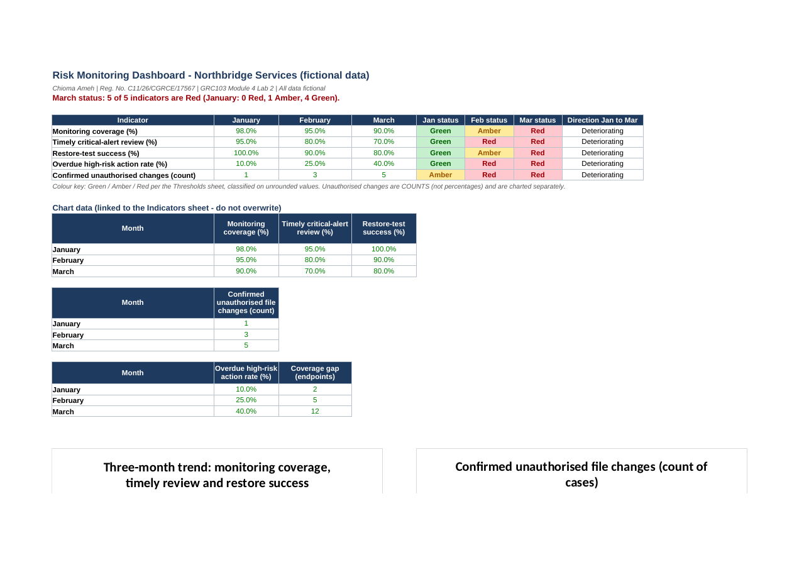
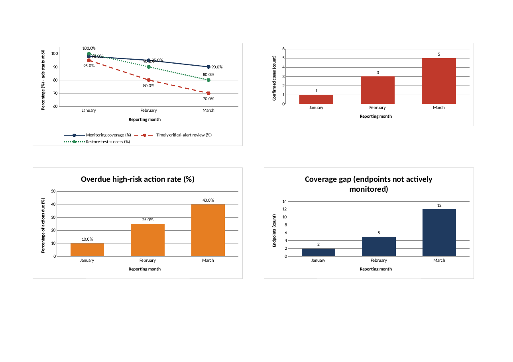

# Risk Monitoring Dashboard and Management Reporting - Northbridge Services (fictional)

| | |
|---|---|
| **Student** | Chioma Ameh |
| **Registration No.** | C11/26/CGRCE/17567 |
| **Course** | GRC103 Practical Laboratories - Module 4 (ICDFA) |
| **Brief** | Analyse three months of fictional monitoring data, classify performance, build a dashboard, update the risk register, plan actions and report to management |
| **Recorded demonstration** | **[ADD LINK HERE]** (read-along script: [`demo/`](demo/)) |

> **All data is fictional** (supplied in the lab brief). No virtual machines or live systems were used. Observed results are separated from assumptions below.

## Result in one view

| Indicator | Jan | Feb | Mar | March status |
|---|---|---|---|---|
| Monitoring coverage | 98.0% Green | 95.0% Amber | 90.0% | **Red** |
| Timely critical-alert review | 95.0% Green | 80.0% Red | 70.0% | **Red** |
| Restore-test success | 100.0% Green | 90.0% Amber | 80.0% | **Red** |
| Overdue high-risk actions | 10.0% Green | 25.0% Red | 40.0% | **Red** |
| Confirmed unauthorised changes | 1 Amber | 3 Red | 5 | **Red** |

All five indicators are Red in March (January: four Green, one Amber). March coverage gap: **12 endpoints** (120 eligible - 108 monitored). Three priority concerns: delayed alert review, failing restore tests, monitoring blind spot. Four risks (R-01 to R-04) score 12, 16, 15 and 12 - all High.




## Required evidence - where to find it

| Required evidence | Location |
|---|---|
| 1. Calculation workbook with source data and **visible formulas** | [`workbook/`](workbook/) - sheets `Data`, `Thresholds`, `Indicators`; formulas also listed in [`docs/calculations.md`](docs/calculations.md) |
| 2. Dashboard with threshold classifications and labelled charts | workbook sheet `Dashboard` (colour-coded status table + 4 labelled charts); images in [`docs/images/`](docs/images/) |
| 3. Risk register with four justified entries | workbook sheet `RiskRegister`; [`docs/risk_register.md`](docs/risk_register.md); PDF page 1 |
| 4. Action plan with owners, deadlines and closure evidence | workbook sheet `ActionPlan`; [`docs/action_plan.md`](docs/action_plan.md); PDF page 2 |
| 5. One-page management report | PDF page 3 of [`report/`](report/); text in [`docs/management_report.md`](docs/management_report.md) |
| Demonstration | recorded video (link above); script in [`demo/`](demo/) |

## Repository layout

```
README.md
workbook/   editable Excel workbook (8 sheets, live formulas, charts)
report/     3-page PDF: risk register, action plan, one-page management report
demo/       read-along script for the recorded demonstration
docs/       readable copies: calculations, risk register, action plan, management report, images
```

## Workbook sheets

| Sheet | Purpose |
|---|---|
| `Data` | Source dataset exactly as given (blue = input) |
| `Thresholds` | Green/Amber/Red boundaries referenced by the status formulas |
| `Indicators` | Indicator formulas with N/A guards, status classification, supporting calculations (gap, late alerts, failed restores) |
| `Dashboard` | Status table, trend direction, four labelled charts (unauthorised changes charted separately as counts) |
| `Interpretation` | Three priority concerns, consequences, observation vs possible cause, effect of the rise in eligible endpoints |
| `RiskRegister` | Four entries with likelihood x impact, band formula, justification, owner, review date, escalation |
| `ActionPlan` | Eight proposed actions (containment + improvement per risk), owners, deadlines from the report date, closure evidence, outcome tests, escalation log |
| `Notes` | Observed vs assumed, method notes, colour legend |

## Method notes

- **Formulas:** percentages follow the brief (`part / total x 100`), displayed to one decimal place; classification uses **unrounded** values. A zero denominator returns `N/A`, never 0% or 100%.
- **Boundary values** are classified by the stated rule: Jan coverage 98.0 = Green, Jan timely review 95.0 = Green, Feb coverage 95.0 = Amber, Feb restore success 90.0 = Amber, Jan overdue rate 10.0 = Green.
- **Charts:** percentage indicators share one labelled percentage axis (starting at 60, stated in the axis title); unauthorised changes are counts and have their own chart.
- **Escalation (exercise rules, not ICDFA policy):** Red indicators go to the responsible manager within one working day; High/Critical scores go to management.

## Observed vs assumed

- **Observed / calculated:** all indicator values, statuses, the coverage gap and supporting counts - computed from the fictional dataset.
- **Assumptions:** possible causes (hypotheses), likelihood and impact ratings, existing-control details, owners (fictional role titles), deadlines, and the **report date (6 Apr 2026)**. Change one cell on `ActionPlan` to recalculate every deadline. No action is marked completed.
- **Limits:** three monthly observations cannot establish a reliable long-term trend or forecast; an alert is not necessarily an incident; correlation does not prove causation.

## Honesty and security note
No credentials, personal data or real system data are in this repository. All names, roles and figures are fictional or proposed for the exercise.
