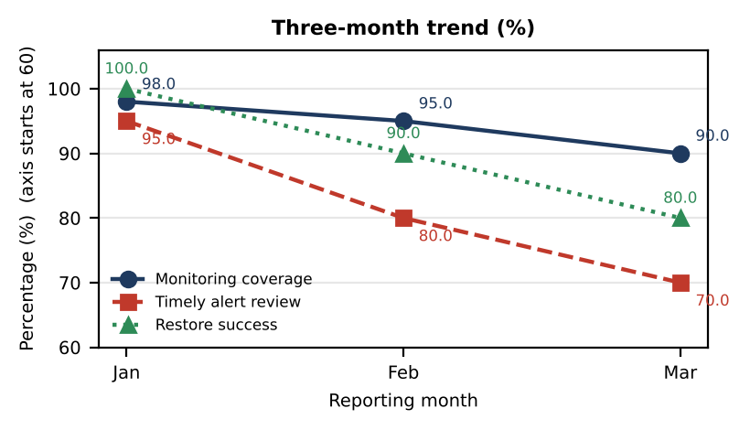
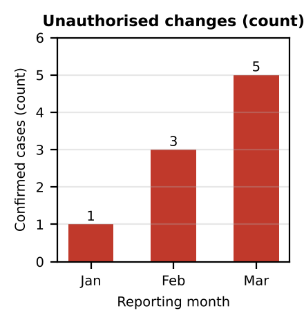

# Management report - control performance, March

**To:** Head of Operations | **From:** Chioma Ameh, GRC Analyst (Reg. No. C11/26/CGRCE/17567) | **Report date:** 6 April 2026 (assumed) | Northbridge Services - fictional exercise data

(The formatted one-page version is page 3 of `../report/GRC103_Lab4_Risk_Report_Chioma_Ameh_C11-26-CGRCE-17567.pdf`.)

## March status
**All five indicators are Red in March** (January: four Green, one Amber). Every indicator has worsened month after month. Red indicators go to their responsible managers within one working day; all four registered risks are High and need management escalation.

| Indicator | Jan | Feb | Mar | March status |
|---|---|---|---|---|
| Monitoring coverage | 98.0% | 95.0% | 90.0% | Red |
| Timely critical-alert review | 95.0% | 80.0% | 70.0% | Red |
| Restore-test success | 100.0% | 90.0% | 80.0% | Red |
| Overdue high-risk actions | 10.0% | 25.0% | 40.0% | Red |
| Confirmed unauthorised changes (count) | 1 | 3 | 5 | Red |

 

## Three priority concerns (observed figures; causes are hypotheses)
1. **Delayed alert review:** 70.0% reviewed within 24h (28 of 40; Jan 95.0%); 12 critical alerts waited longer while alert volume doubled (20 to 40). Confirmed unauthorised changes rose 1, 3, 5. Consequence: threats may stay uninvestigated for over a day. Possible cause: review capacity has not scaled with volume - not proven; an alert is not necessarily an incident.
2. **Failing restore tests:** 80.0% success (8 of 10; Jan 100.0%); 2 failures in March, 1 in February. Consequence: critical data may not be recoverable after an incident. Possible cause: backup faults or scope gaps - to be investigated.
3. **Monitoring blind spot:** coverage 90.0% (108 of 120; Jan 98.0%), a **gap of 12 endpoints** (Feb 5). The monitored count rose by 13, which looks like progress, but eligible endpoints rose by 20, so coverage fell. Consequence: activity on 12 endpoints could go undetected. Possible cause: new endpoints not yet onboarded. Overdue high-risk actions (40.0%, 6 of 15) are a fourth Red indicator, handled as risk R-04.

## Decisions and resources requested
1. Approve temporary extra alert-triage cover for about six weeks (sizing to be validated; assumption) to clear the backlog and meet the 24-hour target (A3, A4).
2. Direct onboarding, exemption or decommissioning of the 12 unmonitored endpoints by 13 Apr 2026 (A1).
3. Require verified re-tests of the 2 failed restores and a monthly restore programme (A5, A6).
4. Chair a weekly review of the 6 overdue actions and back owner reassignment (A7, A8).

## Owners and next review
Endpoint Security Manager 13 Apr (A1); Security Operations Lead 9 Apr (A3); Backup and Recovery Manager 13 Apr (A5); Risk and Compliance Manager 8 Apr (A7). **Next review:** interim action-status review 20 Apr 2026; full review with April indicators in the first week of May 2026. An action counts as closed only when its outcome test is met.

*All data is fictional. Three monthly observations cannot establish a reliable long-term trend or forecast; correlation does not prove causation, and alerts are not necessarily incidents.*
